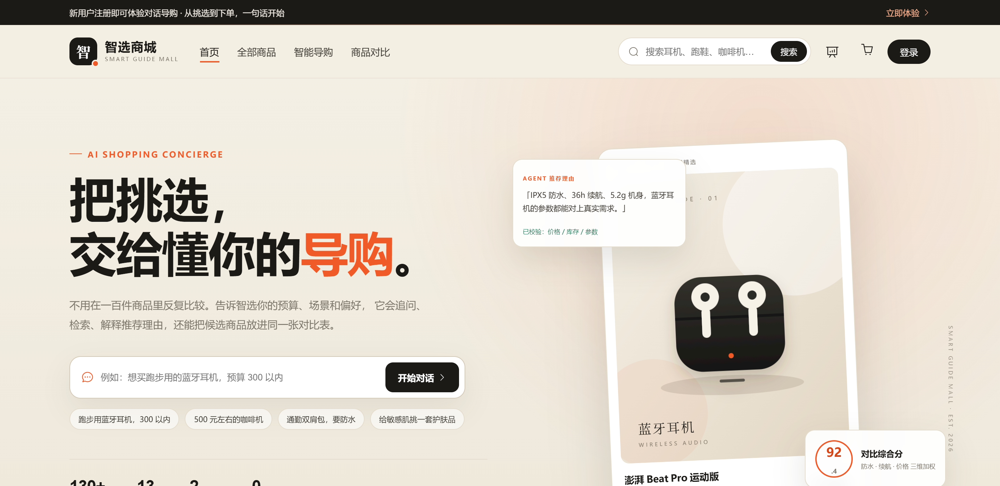
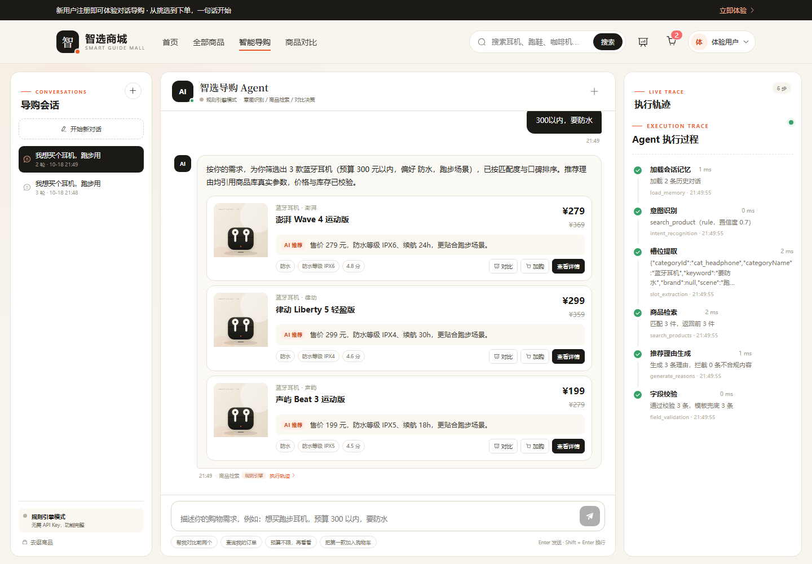
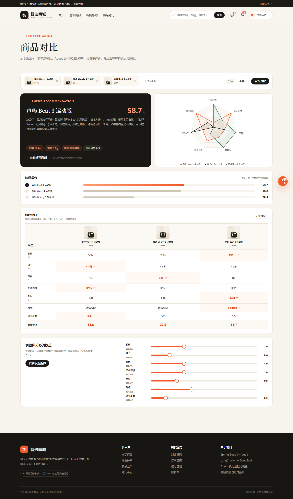
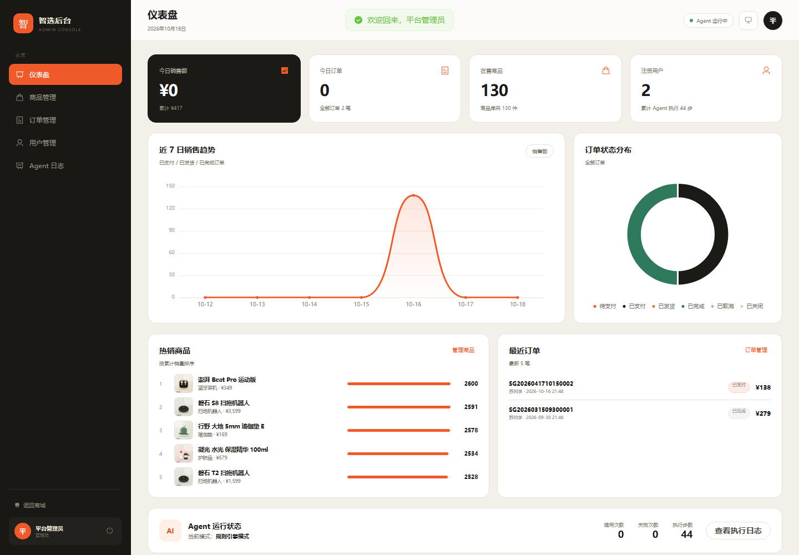

# 智选商城 · 智能导购 Agent 电商平台

> 以对话为核心交互方式的电商系统：用户可以直接逛、搜、加购、下单，也可以把预算和场景告诉导购 Agent，让它完成需求澄清、商品检索、推荐理由生成、多商品对比与订单查询。

题目对应：**基于大语言模型的智能导购 Agent 设计与实现——以电商平台为落地场景**。



| 对话导购 | 对比决策 |
| --- | --- |
|  |  |



---

## 1. 项目亮点

| 能力 | 实现 |
| --- | --- |
| 多轮对话与槽位记忆 | 会话槽位持久化，支持品类 / 预算 / 品牌 / 场景 / 功能偏好，指代消解（A 款、第二个、前两个） |
| 意图识别 | LLM 分类 + 强规则兜底/纠偏，7 类意图 |
| 主动澄清 | 缺少品类或预算时先追问，再检索 |
| 商品检索 | MySQL/H2 结构化过滤 + 关键词 / 功能 / 场景 / 评分 / 销量加权排序 |
| 个性化推荐 | 用户偏好（品类/场景/品牌）参与 Agent 排序，对话中显示“已应用偏好” |
| 可解释推荐 | 推荐理由只引用数据库真实字段，输出前做价格、库存、属性一致性校验 |
| 对比决策 Agent | 结构化对比矩阵、枚举/数值归一化、可调权重、雷达图与决策建议 |
| 幻觉治理 | 输入结构化、检索真实化、输出校验化、LLM 不可用降级 |
| 执行过程可视化 | 每一步写入 `agent_execution_log`，WebSocket 实时推送 |
| 完整电商闭环 | 注册登录、改密、商品、收藏、购物车、地址、订单、模拟支付、物流单号、评价、售后、后台管理 |
| 后台运营 | 商品/分类/订单/售后/评价/用户/会话审查/Agent 日志/统计 |
| 无 Key 可运行 | 未配置 DeepSeek API Key 时自动切换规则引擎，全部功能可演示 |

---

## 2. 技术栈

**后端**：Java 17 · Spring Boot 3.3 · MyBatis-Plus 3.5 · LangChain4j 1.0（DeepSeek OpenAI 兼容接口）· JWT · WebSocket · SpringDoc · H2 / MySQL 8

**前端**：Vue 3.5 · TypeScript 5 · Vite 5 · Element Plus 2 · Pinia · Vue Router 4 · ECharts 5 · Axios

**默认数据库为 H2 文件库**，开箱即用；生产/答辩演示可切换 MySQL 8。

---

## 3. 快速启动

### 3.1 环境

- JDK 17+
- Maven 3.9+
- Node.js 18+
- MySQL 8（可选）

### 3.2 启动后端（默认 H2，自动建表并导入 130 件商品）

```bash
cd backend
mvn spring-boot:run
```

首次启动会自动：

- 创建 `backend/data/smartmall.mv.db`
- 执行 `db/schema.sql`
- 导入 21 个分类（13 个叶子品类）、130 件商品、1300 条评价、演示用户/地址/订单

后端：<http://localhost:8080>  
Swagger：<http://localhost:8080/swagger-ui.html>  
H2 控制台：<http://localhost:8080/h2-console>（JDBC URL：`jdbc:h2:file:./data/smartmall;MODE=MySQL;DATABASE_TO_LOWER=TRUE;CASE_INSENSITIVE_IDENTIFIERS=TRUE`，用户 `sa`，密码空）

### 3.3 启动前端

```bash
cd frontend
npm install
npm run dev
```

访问 <http://localhost:5173>。Vite 已配置 `/api` 与 `/ws` 代理到 `8080`。

### 3.4 演示账号

| 角色 | 用户名 | 密码 |
| --- | --- | --- |
| 普通用户 | `demo` | `Demo@123` |
| 管理员 | `admin` | `Admin@123` |

`demo` 已预置收货地址、购物车、收藏、偏好和两笔演示订单。

### 3.5 可选：切换 MySQL

```sql
CREATE DATABASE smart_mall DEFAULT CHARACTER SET utf8mb4 COLLATE utf8mb4_unicode_ci;
```

```bash
# Linux / macOS
SPRING_PROFILES_ACTIVE=mysql MYSQL_PASSWORD=你的密码 mvn spring-boot:run

# Windows PowerShell
$env:SPRING_PROFILES_ACTIVE="mysql"; $env:MYSQL_PASSWORD="你的密码"; mvn spring-boot:run
```

连接参数可用 `MYSQL_HOST`、`MYSQL_PORT`、`MYSQL_DB`、`MYSQL_USER`、`MYSQL_PASSWORD` 覆盖。表结构由应用自动创建。

也可直接使用仓库内 `docker-compose.yml` 启动 MySQL：

```bash
docker compose up -d
```

### 3.6 接入 DeepSeek（可选）

```bash
# Linux / macOS
export DEEPSEEK_API_KEY=sk-xxxx

# Windows PowerShell
$env:DEEPSEEK_API_KEY="sk-xxxx"
```

相关配置在 `backend/src/main/resources/application.yml` 的 `llm` 节点：

```yaml
llm:
  api-key: ${DEEPSEEK_API_KEY:}
  base-url: ${DEEPSEEK_BASE_URL:https://api.deepseek.com/v1}
  model: ${DEEPSEEK_MODEL:deepseek-flash}
  max-consecutive-failures: 3
  cooldown-seconds: 60
```

当前 DeepSeek 官方模型名为 `deepseek-flash`（推荐，便宜且支持 JSON/Tool Calls）和 `deepseek-v4-pro`（更强、更贵）。本项目默认使用 `deepseek-flash`；旧名 `deepseek-chat` 不再建议依赖。

未配置 Key 时，意图、槽位、理由和对比建议全部走规则/模板引擎，前端会显示“规则引擎模式”。

---

## 4. 演示路径

1. 登录 `demo / Demo@123`。
2. 进入「智能导购」：`我想买个耳机，跑步用` → Agent 会追问预算。
3. 输入 `300以内，要防水` → 返回 3 款商品卡片，右侧执行轨迹实时更新。
4. 点击 `帮我对比前两个` → 返回对比结论，可进入对比页看矩阵和雷达图。
5. 调整对比权重 → 重新计算得分。
6. 商品卡片「加购」→ 购物车结算 → 提交订单 → 模拟支付。
7. 对 Agent 说 `我的订单到哪了` → 返回最近订单状态。
8. 用 `admin / Admin@123` 登录 → 后台仪表盘、商品/分类/订单/售后/评价/用户管理、会话审查、Agent 执行日志。

---

## 5. 系统结构

```
G:\EMT
├── backend/                    Spring Boot 后端
│   ├── src/main/java/com/smartmall
│   │   ├── auth/               JWT、登录拦截、权限注解
│   │   ├── user/               用户、地址、偏好、收藏、足迹
│   │   ├── product/            商品、分类、评价
│   │   ├── cart/               购物车
│   │   ├── order/              订单、库存、超时关闭
│   │   ├── agent/              导购 Agent / 对比 Agent / WebSocket / LLM
│   │   ├── admin/              后台管理、统计
│   │   ├── seed/               种子数据导入
│   │   └── common/             统一响应、异常、工具
│   ├── src/main/resources
│   │   ├── db/schema.sql       兼容 H2 / MySQL 的建表脚本
│   │   └── seed/catalog.json   130 件商品数据
│   └── src/test/               全链路集成测试
├── frontend/                   Vue 3 前端
│   ├── src/api/                接口封装
│   ├── src/stores/             auth / cart / compare
│   ├── src/views/              商城、对话、对比、订单、后台
│   └── src/components/         商品卡片、执行轨迹、雷达图等
├── db/mysql-init.sql           创建数据库脚本
├── scripts/generate-catalog.mjs 商品数据生成器
└── docker-compose.yml          可选 MySQL 8
```

---

## 6. Agent 设计

### 6.1 导购 Agent 主流程

```
用户消息
  → 加载会话槽位与最近 10 轮记忆
  → 意图识别（LLM + 规则）
  → 槽位提取 / 合并（LLM + 规则）
  → 缺失品类 / 预算 → 主动澄清
  → 商品检索（结构化过滤 + 加权排序）
  → 推荐理由生成（LLM 或模板）
  → 字段校验（价格 / 库存 / 属性 / 绝对化表述）
  → 保存会话与执行日志
  → WebSocket 推送每一步
```

意图：`search_product`、`compare`、`ask_detail`、`query_order`、`add_to_cart`、`chitchat`、`clarify`。

### 6.2 槽位

```json
{
  "categoryId": "cat_headphone",
  "categoryName": "蓝牙耳机",
  "keyword": null,
  "brand": null,
  "scene": "跑步",
  "minPrice": null,
  "maxPrice": 300,
  "features": ["防水"],
  "budgetUnlimited": false,
  "askedBudget": true,
  "lastProductIds": ["p_headphone_01", "p_headphone_02"]
}
```

槽位随会话持久化；`lastProductIds` 支持“对比前两个”“把第一款加购”“这个怎么样”等指代。

### 6.3 对比 Agent

- 维度来自品类 `attribute_schema`：价格、评分 + 品类参数（续航、防水、重量、降噪等）
- 数值型 min-max 归一化；枚举型按选项顺序归一化；方向支持越高越好 / 越低越好
- 综合分 = Σ(权重 × 归一化值) / Σ权重 × 100
- 可调权重（0.1–3.0），支持前端滑杆重算
- 建议由 LLM 生成并校验价格，失败时使用模板结论
- 每个阶段写入 `agent_execution_log`

### 6.4 幻觉治理四层

1. **输入层**：意图/槽位只输出结构化 JSON，不让模型生成商品事实
2. **检索层**：商品名称、价格、库存、参数全部来自数据库
3. **生成层**：Prompt 强制引用真实字段，禁止编造价格/库存/评分
4. **校验层**：`FieldValidator` 正则校验价格与库存、检查属性引用、拦截绝对化表述；不通过则模板兜底

另外，LLM 连续失败 3 次会熔断 60 秒，期间自动降级为规则引擎，不影响下单等基础功能。

---

## 7. 主要接口

| 模块 | 接口 |
| --- | --- |
| 认证 | `POST /api/user/register`、`POST /api/user/login` |
| 商品 | `GET /api/product/list`、`GET /api/product/{id}`、`GET /api/product/category`、`GET /api/product/search`、`GET /api/product/batch` |
| 购物车 | `GET/POST /api/cart`、`PUT /api/cart/{id}`、`PUT /api/cart/select` |
| 订单 | `POST /api/order`、`GET /api/order/list`、`PUT /api/order/{id}/pay`、`/cancel`、`/confirm` |
| Agent | `POST /api/agent/chat`、`POST /api/agent/compare`、`GET /api/agent/conversations`、`GET /api/agent/logs` |
| WebSocket | `ws://localhost:8080/ws/agent?token=JWT&conversationId=...` |
| 售后 | `POST /api/after-sale`、`GET /api/after-sale`、`GET /api/after-sale/order/{orderId}` |
| 后台 | `GET /api/admin/stats`、`/products`、`/categories`、`/orders`、`/after-sales`、`/reviews`、`/users`、`/conversations`、`/agent-logs` |

完整参数与响应以 Swagger 为准。

---

## 8. 数据模型

`sys_user`、`user_address`、`user_preference`、`browse_history`、`user_favorite`、`category`、`product`、`product_image`、`product_review`、`cart_item`、`orders`、`order_item`、`after_sale`、`conversation`、`dialogue_turn`、`agent_execution_log`、`compare_record`。

商品参数以 JSON 文本存储在 `product.attributes`，品类维度定义在 `category.attribute_schema`，因此同一套对比算法可适配不同品类。

---

## 9. Agent 评测

`evaluation/cases.json` 包含 40 条对话用例（7 类意图、槽位组合、多轮澄清、指代、订单/加购/对比、边界场景）和 5 项接口检查。

```bash
# 先启动后端，再运行
node evaluation/run-eval.mjs
```

输出在 `evaluation/reports/`：

- `report-*.json`：完整结果
- `report-*.md`：通过率、分组结果、失败明细
- `manual-review-*.csv`：推荐相关性人工评分表（1-5 分）

同一套用例可以在规则引擎和 DeepSeek 模式下各跑一遍，作为论文的对比实验。可用 `--limit=10`、`--only=S01,D08` 做快速调试，`--strict` 让失败用例返回非零退出码。

本次规则引擎基线（2026-10-22，本机 H2）：40/40 通过，意图 100%、槽位 100%、接口检查 5/5，平均 23ms、P95 57ms。该结果只代表规则基线；仓库未配置 DeepSeek Key，因此没有真实 LLM 准确率数据。按 Flash 当前公开价格，50 条多轮评测通常只需几元，具体以官方价格为准。

## 10. 测试与构建

```bash
# 后端：编译 + 全链路集成测试
cd backend
mvn test

# 后端打包
mvn -DskipTests package
java -jar target/smart-guide-mall.jar

# 前端：类型检查 + 生产构建
cd frontend
npm run typecheck
npm run build
npm run preview

# 可选：用本机 Chrome 跑界面冒烟（需先启动前后端）
node scripts/browser-smoke.mjs
```

集成测试 `SmartMallFlowTest` 覆盖：

登录 → 多轮澄清 → 检索推荐 → 对比评分 → 偏好个性化 → 购物车下单 → 支付 → 发货/物流 → 确认收货 → 售后申请/审核 → 评价审核 → 改密 → Agent 日志 → 后台统计。

测试使用 H2 内存库和 130 件真实种子商品，不依赖外部服务。

> 构建说明：如果在本机沙箱中 Vite 构建报 `spawn EPERM`，把 `TEMP`/`TMP` 指向工作区目录并在完整权限下执行即可；正常开发环境不需要。

---

## 11. 边界说明

- 支付为模拟支付，不接入真实支付渠道
- 不对接真实电商 API，商品数据为演示数据
- LLM 输出存在不确定性，系统通过结构化输出与字段校验降低幻觉，但不承诺 100% 准确
- 不包含语音、图片搜索、真实物流

---

## 12. 后续可扩展

- Redis 缓存会话与热点商品
- Chroma / 向量检索做语义召回，与关键词检索做对比实验
- 用户画像与个性化排序
- 真实支付、售后、优惠券
- Agent 评测集：意图准确率、槽位 F1、推荐相关性、对比建议人工评分
